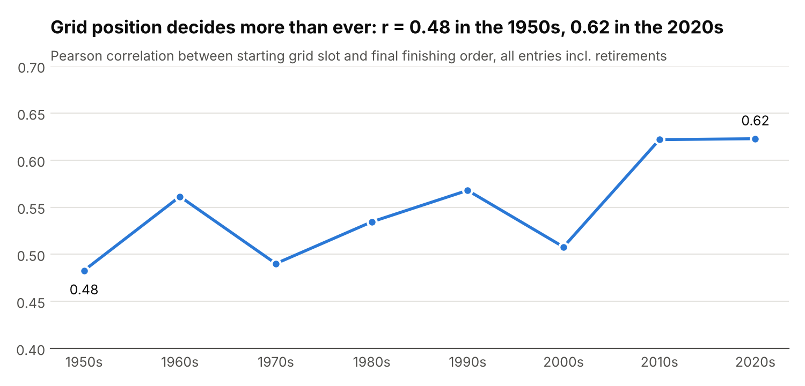
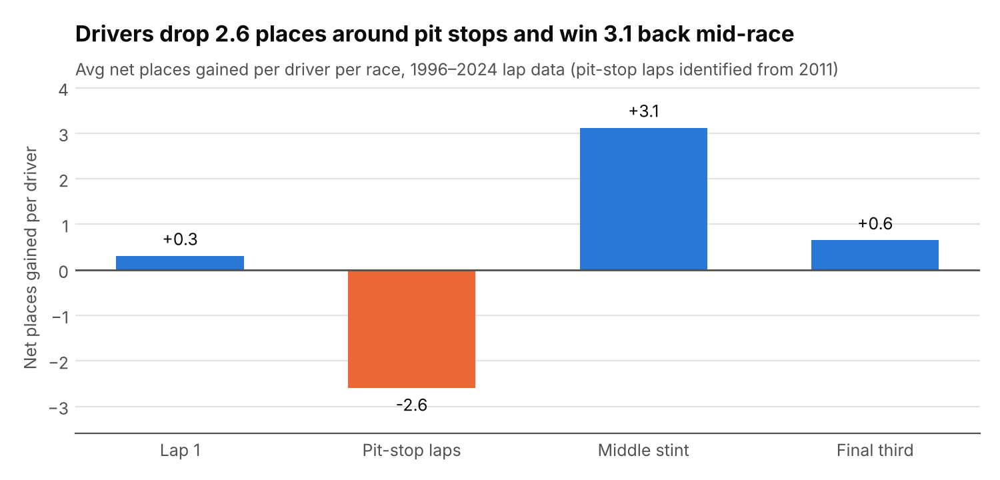
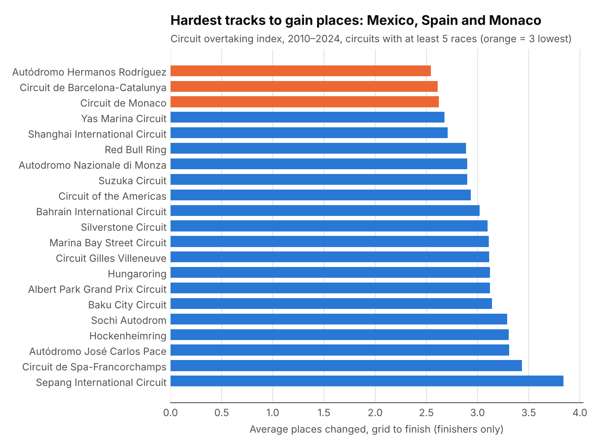
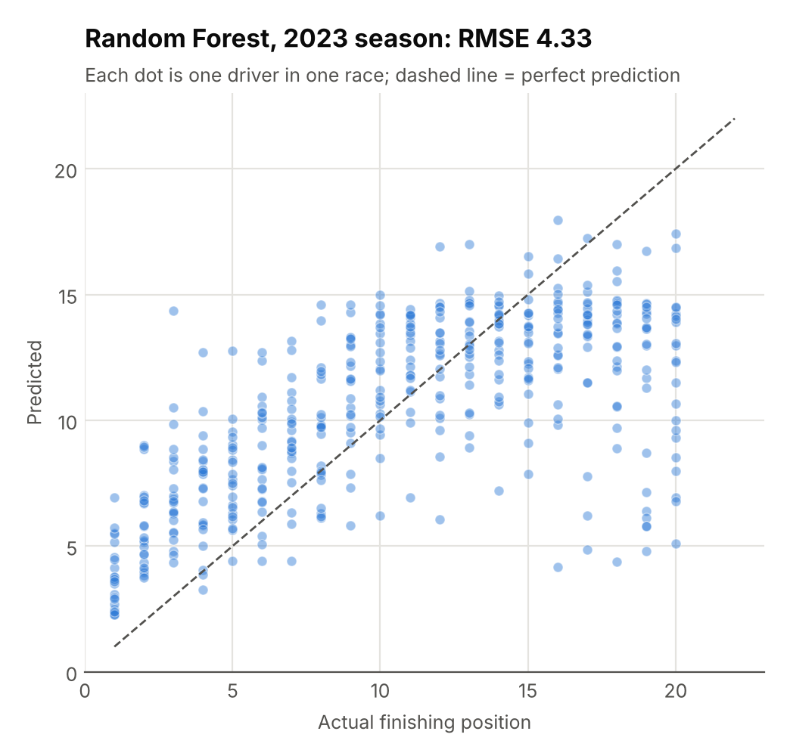

# Does Qualifying Decide the Race?

**Grid-position impact analysis and finishing-position prediction on 75 years of Formula 1 data, using PySpark.**

Big Data Analytics (CSE557) project, Department of Computer Science and Engineering, Ramaiah Institute of Technology, 2026.
Team: Arnav Chatterjee, Khuushi Chand Navin. Faculty guide: Uzma Sulthana.

The pipeline joins 14 relational tables (26,759 race results and 589,081 lap records, 1950–2024) in Apache Spark. It then measures how much grid position decides a race, which circuits are hardest to overtake at, and where in a race places change hands. Finally, it trains Spark MLlib models to predict finishing position and compares them with a 2025 paper ([Urdhwareshe, DOI 10.20944/preprints202504.1471.v1](https://www.preprints.org/manuscript/202504.1471)).

## Key findings

| Question | Result |
| --- | --- |
| Does qualifying matter more now? | Grid–finish correlation rose from 0.48 (1950s) to 0.62 (2010s and 2020s); pole sitters won 42% of races in the 1950s and 52% in the 2020s |
| Where do places change? | Drivers lose a net 2.6 places on pit-stop laps and gain 3.1 back in the middle stint; lap 1 nets +0.3 |
| Hardest circuits to overtake at (2010–2024) | Mexico City (2.54), Barcelona (2.61), Monaco (2.62); easiest: Sepang (3.84), Spa (3.43), Interlagos (3.31) |
| Can we predict the finish? | Random Forest cuts RMSE by 16% versus "finish = grid"; grid, team form and qualifying gap matter most |





## Comparison with the paper

The paper reports RMSE 2.87 for its TabNet driver model on the 2023 season. Our pre-race model scores 4.33 on the same season, but the two setups differ. We tested each difference using the same split (train 2010–2022, test 2023):

| Model | Test rows | RMSE | MAE | R² |
| --- | --- | --- | --- | --- |
| Baseline: finish = grid | all | 5.15 | 3.70 | 0.20 |
| Random Forest, pre-race features (ours) | all | 4.33 | 3.36 | 0.44 |
| GBT, pre-race features (ours) | all | 4.67 | 3.59 | 0.34 |
| Random Forest, paper's features incl. laps completed | all | 3.52 | 2.64 | 0.63 |
| **Random Forest, pre-race features (ours)** | **finishers only** | **3.25** | **2.46** | **0.61** |
| Random Forest, paper's features incl. laps completed | finishers only | 3.29 | 2.52 | 0.59 |
| TabNet (paper, reported) | finishers only | 2.87 | 2.17 | 0.75 |

Two choices in the paper explain most of the gap:

- It uses "laps completed", which is only known after the race.
- It drops drivers with no finish position, i.e. retirements.

On the paper's terms, our pre-race model reaches 3.25, slightly ahead of the paper's own features (3.29). The remaining gap of about 0.4 places may come from TabNet with Optuna tuning and from the paper's unpublished data file; we did not test those.



## Performance (Spark 4.3 local mode, 2 vCPU, 7.8 GB RAM; median of 5 runs)

| Measure | Result |
| --- | --- |
| Overtaking-index query, uncached vs cached | 0.74 s vs 0.33 s (2.2× faster) |
| 589k-row lap aggregation, 1 / 2 / 4 / 8 partitions | 0.05 / 0.12 / 0.12 / 0.17 s |
| Same read + group-by, pandas vs Spark | 0.24 s vs 0.88 s |
| Correctness check, Spark vs pandas | 11,041 = 11,041 (race, driver) groups |

At about 21 MB on 2 cores, Spark's scheduling overhead outweighs parallelism. Caching is the clear gain here. Spark's value is that the same code scales to larger data, such as OpenF1 car telemetry, without a rewrite. All measured values are in [`output/metrics.json`](output/metrics.json).

## How to run

**1. Get the data.** Download the dataset from [Kaggle](https://www.kaggle.com/datasets/rohanrao/formula-1-world-championship-1950-2020) (free login) and unzip the 14 CSVs into a folder named `data` next to the script. The CSVs are not included in this repository.

**2. Install.** Python 3.10+ and **Java 17 or 21** (needed by Spark 4).

```bash
pip install -r requirements.txt
```

**3. Run.** A full run takes about 3 minutes.

```bash
python f1_bda_pipeline.py --data ./data --out ./output
# add --skip-perf to skip the timing benchmarks
```

**On Windows:** install a Java 17 or 21 JDK (e.g. Eclipse Temurin) and make sure `java -version` works in a new terminal. If Spark cannot find Python, set `PYSPARK_PYTHON=python` before running.

**On Google Colab:** upload the CSVs to a `data` folder, then run `!pip install pyspark` followed by `!python f1_bda_pipeline.py --data data --out output`. Colab already has Java.

## Workflow

```
Data (14 CSVs) → Cleaning → Processing → Analysis → Insights
```

1. **Cleaning:** `\N` markers become nulls; duplicate rows from 1950s–60s shared drives (91) are removed; pit-lane starts (grid = 0) go to the back of the grid; qualifying times are parsed to seconds.
2. **Processing:** results are joined with races, circuits, status and qualifying. Window functions compute the gap to pole and each driver's and team's form over their previous 5 races.
3. **Analysis:** correlation by decade, circuit overtaking index, lap-by-lap gains by race phase (lap 1, pit-stop laps, middle stint, final third), and MLlib Random Forest and GBT models.
4. **Insights:** CSVs, charts and `metrics.json` are written to `output/`.

## Repository layout

| Path | Contents |
| --- | --- |
| `f1_bda_pipeline.py` | The whole pipeline |
| `output/` | Results from the full run: CSVs, `metrics.json`, charts, 2023 predictions |
| `report/` | Scripts that build the print-sized figures and the 4-page report from `output/` |
| `requirements.txt` | Python dependencies |

## References

1. Urdhwareshe, A. (2025). *The Use of Machine Learning in Predicting Formula 1 Race Outcomes.* Preprints.org. [DOI 10.20944/preprints202504.1471.v1](https://www.preprints.org/manuscript/202504.1471)
2. Rao, R. *Formula 1 World Championship (1950–2024).* [Kaggle](https://www.kaggle.com/datasets/rohanrao/formula-1-world-championship-1950-2020)
3. Weissbock, J. & Mills, S. (2025). *Evaluating the Predictive Power of Qualifying Performance in Formula One Grand Prix.* [arXiv:2507.10966](https://arxiv.org/abs/2507.10966)
4. [Apache Spark MLlib Guide](https://spark.apache.org/docs/latest/ml-guide.html)
5. [Jolpica-F1 API](https://github.com/jolpica/jolpica-f1), the source the dataset is built from

The data comes from the public Ergast/Jolpica database via Kaggle and is used here for academic, non-commercial work.
